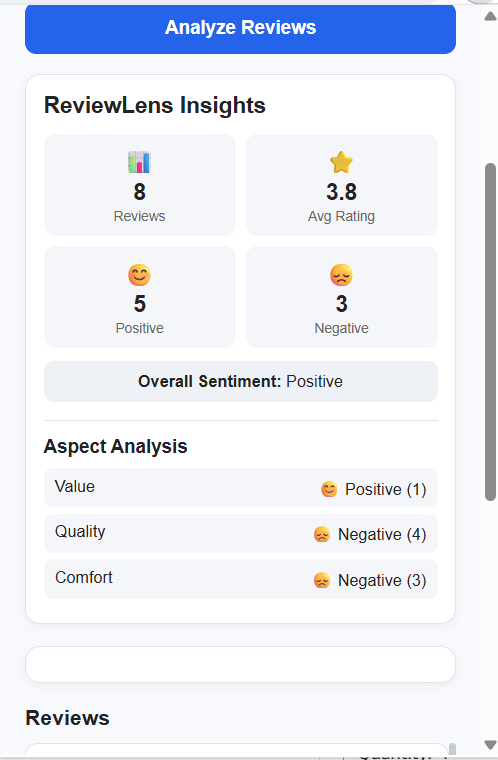
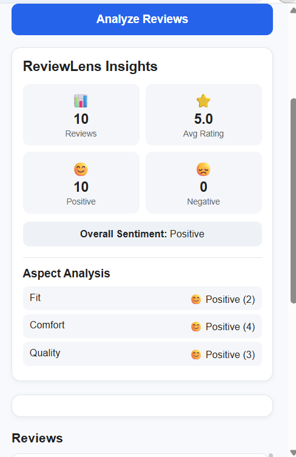
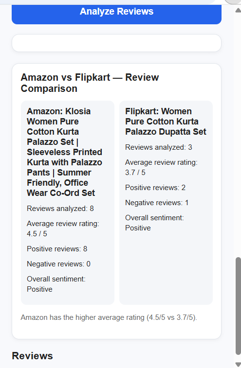

ReviewLens 🔍
AI-Powered E-Commerce Review Intelligence
ReviewLens is an AI-powered Chrome extension that helps shoppers understand customer feedback on Amazon and Flipkart. It analyzes accessible product reviews using natural language processing (NLP), highlights sentiment and product aspects, detects semantically similar reviews, and supports side-by-side comparisons across the two platforms.

The system combines a Manifest V3 Chrome extension, a FastAPI backend, and a separate ONNX inference worker deployed on Render.
Features

- Sentiment analysis: Classifies extracted reviews as positive or negative using DistilBERT.
- Aspect-based insights: Identifies mentions of Quality, Comfort, Fit, Value, and Durability and summarizes associated sentiment.
- Semantic similarity: Uses MiniLM sentence embeddings and cosine similarity to compare review meaning.
- Duplicate and similar-review detection: Flags reviews with high semantic similarity.
- Cross-platform comparison: Finds candidate products on the other marketplace, asks the user to confirm the match, and compares their reviews side by side.
- Review dashboard: Shows analyzed review counts, sentiment summaries, average ratings where available, and aspect-level insights.
- Cloud inference: Runs quantized ONNX models in a separate inference service rather than loading both models in the main backend.
  Current Status
  The following workflows have been tested successfully during development:
  Workflow Status
  Amazon review extraction and analysis Working in local extension testing
  Flipkart review extraction and analysis Working in local extension testing
  Amazon → Flipkart comparison Working in local extension testing
  Flipkart → Amazon comparison Working in local extension testing
  FastAPI backend on Render Deployed
  ONNX inference worker on Render Deployed
  Chrome Web Store publication Not yet published

Review extraction depends on the structure and availability of reviews on each product page. Results may vary across listings and as marketplace layouts change.
System Architecture
Amazon / Flipkart product pages
|
v
Chrome Extension (Manifest V3)

- Content script: review extraction
- Popup: analysis and comparison UI
  |
  v
  FastAPI Backend (Render)
- Request handling
- Aspect and similarity analysis
  |
  v
  Authenticated ONNX Inference Worker (Render)
  / \
   v v
  DistilBERT (INT8) MiniLM (INT8)
  Sentiment prediction Sentence embeddings
  \ /
  v v
  Analysis results
  |
  v
  ReviewLens dashboard
  Technology Stack
  Layer Technologies
  Extension UI HTML, CSS, JavaScript
  Browser integration Chrome Extension Manifest V3
  Backend API Python, FastAPI
  Sentiment model DistilBERT
  Sentence embeddings MiniLM
  Similarity analysis Cosine similarity
  Model optimization ONNX Runtime, INT8 quantization
  Deployment Render
  Version control Git, GitHub

How It Works
Analyze reviews

1. Open a supported Amazon or Flipkart product page.
2. Open the ReviewLens extension and select Analyze Reviews.
3. The extension extracts accessible reviews from the page.
4. The FastAPI backend requests sentiment predictions and embeddings from the ONNX inference worker.
5. The backend computes review similarity and aspect-based insights.
6. ReviewLens displays the analysis in the extension popup.
   Compare products across platforms
7. Open a product on Amazon or Flipkart.
8. Use ReviewLens to find candidate products on the other platform.
9. Confirm the correct match from the suggestions.
10. ReviewLens extracts available reviews from the original and matched product pages.
11. The backend analyzes both review sets independently.
12. The extension displays a side-by-side comparison.
    Note: Product suggestions are not guaranteed to refer to identical products. Always verify the match before comparing results.
    Repository Structure
    ReviewLens/
    ├── backend/
    │ ├── .python-version
    │ ├── main.py
    │ ├── inference_client.py
    │ └── requirements.txt
    ├── extension/
    │ ├── manifest.json
    │ ├── content.js
    │ ├── popup.html
    │ ├── popup.css
    │ └── popup.js
    ├── inference-worker/
    │ ├── app_onnx.py
    │ ├── Dockerfile.onnx
    │ ├── requirements-onnx.txt
    │ └── README.md
    ├── models-onnx/
    │ ├── distilbert-int8/
    │ └── minilm-int8/
    ├── DEPLOYMENT.md
    └── README.md
    Additional development and test files are present in the repository. Local virtual environments and temporary benchmarking scripts are excluded from version control.
    Installation
    Option 1: Load the extension with the deployed backend (recommended)
    The extension currently points to the hosted FastAPI backend, so you do not need to install Python to try the deployed configuration.
13. Clone the tested development branch:
    git clone --branch experiment/onnx-optimization https://github.com/Aanya10052006/ReviewLens.git
    cd ReviewLens
14. Open chrome://extensions in Google Chrome.
15. Turn on Developer mode.
16. Click Load unpacked.
17. Select the repository's extension folder.
18. Open a supported Amazon or Flipkart product page and launch ReviewLens.
    The extension is configured for www.amazon.in, www.amazon.com, and www.flipkart.com.
    Free-tier hosting: The Render services may take time to wake up after inactivity. A successful health check does not necessarily guarantee that an inference request will succeed immediately.

Option 2: Run the FastAPI backend locally
The backend still requires a compatible inference service; it does not load the sentiment and embedding models directly in the current deployed architecture.

1. From the repository root, enter the backend directory:
   cd backend
2. Create and activate a virtual environment (Windows PowerShell):
   python -m venv .venv
   .\.venv\Scripts\Activate.ps1
3. Install dependencies:
   pip install -r requirements.txt
4. Configure the inference worker connection in the same PowerShell session:
   $env:INFERENCE_URL = "https://YOUR-INFERENCE-SERVICE"
   $env:INFERENCE_API_KEY = "YOUR_PRIVATE_API_KEY"
   Use credentials for an inference service you control. Never commit real API keys to GitHub. The hosted worker requires authentication; its private key is not distributed with this repository.
5. Start the backend:
   uvicorn main:app --host 127.0.0.1 --port 8001
6. To make the extension use your local backend, change the first line of extension/popup.js from:
   const BACKEND_URL = "https://reviewlens-backend-soar.onrender.com";
   to:
   const BACKEND_URL = "http://127.0.0.1:8001";
7. Reload ReviewLens on chrome://extensions and refresh the product page.
   To return to the deployed configuration, restore the hosted BACKEND_URL and reload the extension again.

For more deployment information, see [DEPLOYMENT.md](DEPLOYMENT.md) and [the inference worker README](inference-worker/README.md).
Deployment
ReviewLens uses two separately deployed Render services:
Service URL Health check
FastAPI backend reviewlens-backend-soar.onrender.com Backend health
ONNX inference worker reviewlens-onnx-worker.onrender.com Worker health

The backend calls the inference worker using an API key. The /health endpoints are useful for checking service availability; they do not perform a full review analysis.
Model Optimization
The initial architecture used transformer models for sentiment classification and sentence embeddings. To make deployment more practical on resource-constrained infrastructure, ReviewLens uses INT8-quantized ONNX exports of DistilBERT and MiniLM in a separate inference worker.

This separation avoids loading both models into the main FastAPI process and allows the API and inference components to be deployed independently. It does not eliminate all free-tier memory, cold-start, or latency constraints.
## Screenshots

### Amazon Review Analysis

### Flipkart Review Analysis

### Amazon vs Flipkart Comparison

---

Known Limitations

- Marketplace page structures can change, affecting extraction reliability.
- Some listings expose only a subset of reviews to the extension.
- Cross-platform candidate matching requires manual confirmation.
- Free-tier services may experience cold starts or temporary inference errors.
- The extension has been tested locally but has not been published to the Chrome Web Store.
  Future Improvements
- Improve product matching accuracy and validation.
- Increase review extraction coverage across different listing layouts.
- Add automated tests for both comparison directions.
- Improve error handling, observability, and inference latency.
- Explore support for additional e-commerce platforms.
  Project Context
  ReviewLens is a collaborative academic project developed by a three-member team under milestone-based requirements. Development included browser extension engineering, NLP model integration, API development, model optimization, testing, and cloud deployment.
  Disclaimer
  ReviewLens is an independent academic project and is not affiliated with Amazon or Flipkart. Analysis reflects only the reviews accessible to the extension at the time of extraction and should not be treated as a complete or definitive assessment of a product.
